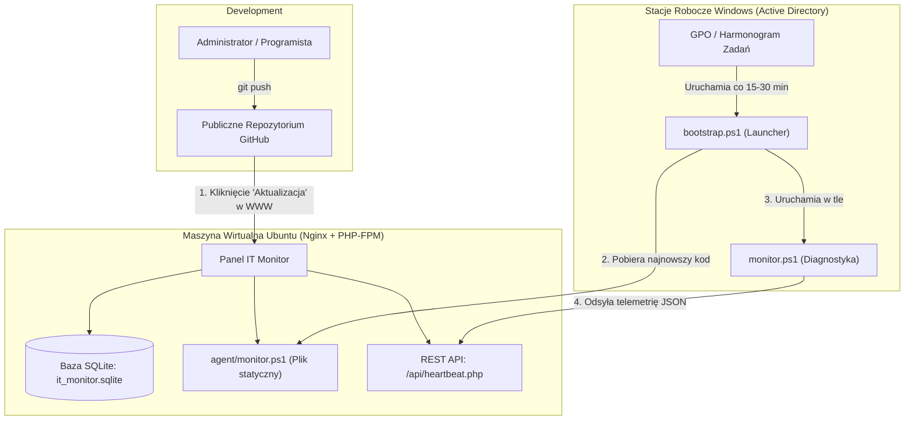

# Gmina IT Monitor — Lokalny monitoring infrastruktury Windows

**Gmina IT Monitor** to lekkie, bezpieczne i niezależne rozwiązanie do ciągłego monitorowania komputerów z systemem Windows w urzędzie gminy, jednostce samorządowej lub firmie. 

System opiera się na bazie **SQLite** (lub MySQL), backendzie w czystym **PHP 8.x** bez zewnętrznych frameworków oraz natywnym agencie **Windows PowerShell 5.1+**, który nie wymaga instalacji żadnych dodatkowych modułów ani uprawnień administratora.

---

## 1. Architektura systemu i przepływ aktualizacji

Całość została zaprojektowana tak, aby **administrator nie musiał logować się na serwer ani modyfikować GPO przy każdej zmianie w kodzie**:



### Kluczowe zalety tej architektury:
1. **Publiczny GitHub = Zero konfiguracji kluczy:** Ponieważ repozytorium jest publiczne, serwer Ubuntu pobiera aktualizacje przez czyste HTTPS (`git pull` lub przycisk w panelu WWW) bez konieczności generowania kluczy SSH czy personal access tokenów.
2. **Pancerna ochrona danych (SQLite + config.php):** Baza danych `database/it_monitor.sqlite` oraz konfiguracja `config/config.php` są wpisane do `.gitignore`. Aktualizacja kodu z GitHuba **nigdy ich nie nadpisze ani nie skasuje**.
3. **Pasywne GPO (Auto-Patcher na stacjach):** W Active Directory wdrażasz tylko lekki skrypt `bootstrap.ps1`. Przy każdym wywołaniu pobiera on aktualną wersję `monitor.ps1` bezpośrednio z serwera Nginx. Jeśli zmienisz testy w kodzie na GitHubie i zaktualizujesz serwer, **wszystkie komputery w urzędzie automatycznie zaczną używać nowego skryptu**.

---

## 2. Struktura katalogów

```text
it-monitor/
├── index.php                     # Główny interfejs dashboardu (z obsługą aktualizacji)
├── config/
│   ├── config.example.php        # Wzorzec konfiguracji
│   ├── config.php                # Lokalna konfiguracja serwera (wykluczona z Git)
│   └── nginx-it-monitor.conf     # Gotowa konfiguracja wirtualnego hosta dla Nginx na Ubuntu
├── api/
│   ├── heartbeat.php             # Odbiór raportów diagnostycznych od agentów
│   ├── devices.php               # Lista stacji roboczych i podsumowanie
│   ├── history.php               # Historia wykonanych testów z filtrami
│   ├── incidents.php             # Rejestr awarii i zdarzeń
│   ├── update_device.php         # Przypisywanie referatu i pokoju do komputera
│   ├── system_update.php         # Samoczynna aktualizacja aplikacji z GitHuba
│   └── health.php                # Diagnostyka stanu API i bazy SQLite
├── includes/
│   ├── db.php                    # Obsługa bazy danych PDO (SQLite / MySQL) i auto-migracje
│   ├── auth.php                  # Weryfikacja skrótów SHA-256 tokenów urządzeń
│   └── functions.php             # Walidacja, zarządzanie incydentami i bezpieczeństwo
├── assets/
│   ├── css/style.css             # Stylowanie dashboardu (Bootstrap 5 + motyw urzędowy)
│   └── js/dashboard.js          # Dynamiczne odświeżanie, modale i obsługa Git Upd сиtera
├── database/
│   ├── schema.sqlite.sql         # Schemat tabel bazy SQLite
│   └── it_monitor.sqlite         # Plik bazy SQLite (tworzony automatycznie przy 1. uruchomieniu)
├── agent/
│   ├── bootstrap.ps1             # Lekki launcher dla Active Directory (GPO Auto-Patcher)
│   ├── monitor.ps1               # Główny skrypt diagnostyczny PowerShell (pobierany przez stacje)
│   └── config.ps1                # Konfiguracja adresów i testów agenta
├── .gitignore                    # Ochrona bazy danych i haseł przed wypchnięciem na Git
└── README.md                     # Niniejsza dokumentacja techniczna
```

---

## 3. Wdrożenie na Wirtualnej Maszynie Ubuntu z Nginx

Poniższa procedura przeprowadzi Cię przez kompletną instalację systemu na czystej maszynie wirtualnej z Ubuntu Server 22.04 LTS lub 24.04 LTS.

### Krok 1: Instalacja Nginx, PHP i Git
Zaloguj się na maszynę przez SSH i zainstaluj wymagane pakiety:

```bash
sudo apt update && sudo apt upgrade -y
sudo apt install -y nginx git curl
sudo apt install -y php-fpm php-sqlite3 php-curl php-mbstring php-xml
```

Sprawdź wersję zainstalowanego PHP-FPM:
```bash
php -v
ls /var/run/php/
# Zobaczysz np. php8.2-fpm.sock lub php8.3-fpm.sock
```

---

### Krok 2: Sklonowanie publicznego repozytorium z GitHuba

Przejdź do katalogu serwera WWW i sklonuj projekt (zamień URL na adres Twojego repozytorium):

```bash
cd /var/www/html
sudo git clone https://github.com/TWOJ_LOGIN/BugAnalyzer.git it-monitor
```

---

### Krok 3: Uprawnienia dla użytkownika serwera WWW (`www-data`)

Aby Nginx i PHP mogły:
- Zapisywać dane do bazy SQLite w folderze `database/`,
- Tworzyć pliki tymczasowe,
- **Wykonywać samoczynną aktualizację kodu (`git pull / git reset`) przez panel WWW**:

Ustaw właściciela całego katalogu na `www-data`:

```bash
sudo chown -R www-data:www-data /var/www/html/it-monitor
sudo chmod -R 775 /var/www/html/it-monitor
```

---

### Krok 4: Konfiguracja Nginx z zabezpieczeniem bazy SQLite

> [!CAUTION]
> **KRYTYCZNA UWAGA DLA NGINX:** Apache respektuje pliki `.htaccess`, ale **Nginx całkowicie je ignoruje**. Aby nikt z zewnątrz nie mógł pobrać pliku bazy SQLite (`it_monitor.sqlite`) ani plików `.git`, w Nginx **muszą** znaleźć się odpowiednie dyrektywy blokujące.

W repozytorium znajduje się gotowy plik [config/nginx-it-monitor.conf](config/nginx-it-monitor.conf). Skopiuj go do konfiguracji Nginx:

```bash
sudo cp /var/www/html/it-monitor/config/nginx-it-monitor.conf /etc/nginx/sites-available/it-monitor
```

Dostosuj konfigurację (podaj IP lub domenę Twojego serwera oraz właściwą wersję gniazda PHP-FPM):
```bash
sudo nano /etc/nginx/sites-available/it-monitor
```

Przykładowy fragment pliku `/etc/nginx/sites-available/it-monitor`:
```nginx
server {
    listen 80;
    server_name adminmonitor.gminaleszno.local;

    root /var/www/html/it-monitor;
    index index.php index.html;

    client_max_body_size 2M;

    # Główny routing
    location / {
        try_files $uri $uri/ /index.php?$query_string;
    }

    # Zezwolenie stacjom roboczym AD na pobieranie skryptu agenta
    location ^~ /agent/ {
        location ~* \.ps1$ {
            allow all;
            default_type text/plain;
        }
        location ~* config.*\.ps1$ {
            deny all;
            return 404;
        }
    }

    # BLOKADA DOSTĘPU DO BAZY SQLITE I PLIKÓW POUFNYCH:
    location ~* \.(sqlite|sqlite3|db|sql|log)$ {
        deny all;
        return 404;
    }
    location ^~ /database/ {
        deny all;
        return 404;
    }
    location ^~ /config/ {
        deny all;
        return 404;
    }
    location ^~ /includes/ {
        deny all;
        return 404;
    }
    location ~ /\. {
        deny all;
        return 404;
    }

    # Obsługa PHP-FPM
    location ~ \.php$ {
        include snippets/fastcgi-php.conf;
        fastcgi_pass unix:/var/run/php/php8.2-fpm.sock; # Dopasuj do wersji PHP
        fastcgi_param SCRIPT_FILENAME $realpath_root$fastcgi_script_name;
        include fastcgi_params;
    }
}
```

Aktywuj stronę i zrestartuj Nginx:
```bash
sudo ln -s /etc/nginx/sites-available/it-monitor /etc/nginx/sites-enabled/
sudo nginx -t
sudo systemctl reload nginx
```

---

### Krok 5: Konfiguracja lokalna i weryfikacja API

1. Utwórz plik konfiguracyjny z wzorca:
   ```bash
   sudo cp /var/www/html/it-monitor/config/config.example.php /var/www/html/it-monitor/config/config.php
   sudo chown www-data:www-data /var/www/html/it-monitor/config/config.php
   ```
2. Otwórz w przeglądarce test stanu:
   `http://adminmonitor.gminaleszno.local/api/health.php`
   Powinieneś otrzymać odpowiedź JSON:
   ```json
   {
     "success": true,
     "status": "OK",
     "api": "Gmina IT Monitor API",
     "database": { "connected": true, "driver": "sqlite" },
     "php_version": "8.2.x"
   }
   ```
   *(Baza SQLite `database/it_monitor.sqlite` utworzy się automatycznie z domyślnym tokenem).*

3. Otwórz panel główny:
   `http://adminmonitor.gminaleszno.local/`

---

## 4. Jak wykonywać aktualizacje (Workflow z GitHubem)

### Wariant A: Samoczynna aktualizacja jednym kliknięciem z poziomu strony (Zalecane)
1. Wprowadzasz zmiany w kodzie na swoim komputerze i robisz:
   ```bash
   git add .
   git commit -m "Nowy test dysku i poprawki wyglądu"
   git push origin main
   ```
2. Otwierasz panel WWW na serwerze Ubuntu (`http://adminmonitor.gminaleszno.local/`).
3. W prawym górnym rogu klikasz przycisk **`Aktualizacja`**:
   - Wyświetli się okno z bieżącym commitem i datą.
   - Klikasz **„Sprawdź na GitHubie”** — API sprawdzi ile nowych commitów czeka na publicznym repozytorium.
   - Klikasz **„Pobierz i zaktualizuj”** — serwer sam wykona `git fetch` oraz bezpieczny `git reset --hard origin/main`, a strona automatycznie się odświeży.

### Wariant B: Ręczna aktualizacja w konsoli serwera Ubuntu
Jeśli wolisz terminal, wystarczy wpisać:
```bash
cd /var/www/html/it-monitor
sudo -u www-data git pull origin main
```

---

## 5. Wdrożenie Agenta w Active Directory (GPO Auto-Patcher)

Dzięki plikowi [agent/bootstrap.ps1](agent/bootstrap.ps1) **nie musisz wdrażać pełnego kodu agenta przez GPO**. Wdrażasz jedynie 30-linijkowy launcher, który przy każdym uruchomieniu sam zaciąga najświeższy kod z serwera Nginx.

### Krok 1: Przygotowanie adresu URL w bootstrap.ps1
Upewnij się, że parametr `$ServerUrl` w `agent/bootstrap.ps1` wskazuje na adres Twojego serwera Nginx:
```powershell
param(
    [string]$ServerUrl = "http://adminmonitor.gminaleszno.local/agent/monitor.ps1",
    [string]$CacheDir  = "$env:ProgramData\GminaITMonitor"
)
```

### Krok 2: Skonfigurowanie GPO w Active Directory

1. Na Kontrolerze Domeny otwórz konsolę zarządzania zasadami grup: `gpmc.msc`.
2. Utwórz nowy obiekt GPO, np. `GPO_Gmina_IT_Monitor_Agent` i podlinkuj go do jednostki organizacyjnej (OU) ze stacjami roboczymi.
3. Przejdź do:
   **Konfiguracja komputera → Preferencje → Ustawienia panelu sterowania → Zaplanowane zadania (Scheduled Tasks)**.
4. Kliknij prawym przyciskiem myszy → **Nowy → Zaplanowane zadanie (przynajmniej system Windows 7)**:
   - **Karta Ogólne:**
     - Nazwa: `Gmina IT Monitor Auto-Agent`
     - Konto użytkownika: `NT AUTHORITY\SYSTEM` (lub `Uruchom niezależnie od tego, czy użytkownik jest zalogowany`)
     - Zaznacz: **Uruchom z najwyższymi uprawnieniami**
   - **Karta Wyzwalacze (Triggers):**
     - Przy starcie systemu + powtarzaj zadanie co: **15 minut** (przez czas nieokreślony).
   - **Karta Akcje (Actions):**
     - Akcja: **Uruchom program**
     - Program/skrypt: `powershell.exe`
     - Argumenty:
       ```powershell
       -ExecutionPolicy Bypass -NoProfile -WindowStyle Hidden -Command "iex (New-Object System.Net.WebClient).DownloadString('http://adminmonitor.gminaleszno.local/agent/bootstrap.ps1')"
       ```
       *(Możesz też skopiować plik `bootstrap.ps1` do zasobu domenowego `\\twoja-domena\sysvol\...\scripts` i wskazać go parametrem `-File`).*

### Jak działa odporność na brak sieci (Cache):
- Gdy stacja robocza ma połączenie z serwerem Nginx: pobiera najnowszy `monitor.ps1` i zapisuje go w `C:\ProgramData\GminaITMonitor\monitor.ps1`.
- Gdy stacja jest w terenie lub serwer ma restart: skrypt automatycznie uruchamia zapisaną kopię z cache, nie przerywając działania.

---

## 6. Bezpieczeństwo i dobre praktyki

1. **Brak haseł w tekście jawnym:** Tokeny stacji roboczych są hashowane kryptograficznie algorytmem **SHA-256** przed zapisem w bazie.
2. **Pełna izolacja konfiguracji:** Pliki `config/config.php` i `database/it_monitor.sqlite` nie trafiają na publicznego GitHuba dzięki regułom w `.gitignore`.
3. **Prepared Statements (PDO):** Wszystkie operacje bazodanowe są parametryzowane, co eliminuje podatności na SQL Injection.
4. **Ochrona przed przepełnieniem:** API narzuca limit 512 KB na pojedynczy pakiet JSON telemetrii ze stacji.

---

## 7. Diagnostyka i najczęstsze pytania (FAQ)

- **P: Czy po aktualizacji z GitHuba stracę dane o komputerach i historię?**
  - **O:** Nie. Baza danych znajduje się w pliku `database/it_monitor.sqlite`, który jest w `.gitignore`. Git go ignoruje i nie modyfikuje podczas operacji `pull` ani `reset`.
- **P: Dlaczego przycisk „Aktualizacja” zgłasza błąd uprawnień?**
  - **O:** Upewnij się, że katalog projektu na maszynie wirtualnej należy do użytkownika serwera Nginx:
    ```bash
    sudo chown -R www-data:www-data /var/www/html/it-monitor
    ```
- **P: Jak dodać nowy test dla komputerów (np. sprawdzenie antywirusa)?**
  - **O:** Wystarczy dopisać test w pliku `agent/monitor.ps1`, zrobić `git push origin main`, a w panelu WWW kliknąć **„Pobierz i zaktualizuj”**. Komputery w urzędzie przy następnym cyklu GPO (np. za 15 min) same pobiorą nowy skrypt.
